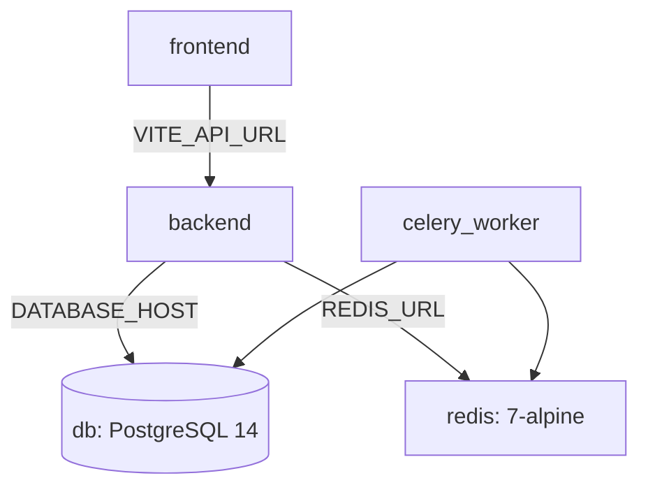

# Chapter 11: Local Conda Environment & Docker Containerization Setup

Osdag-Web supports two deployment topologies: a local Conda-based environment for development, and a containerized Docker topology optimized for high-concurrency production workloads.

---

## 11.1 Conda Environment Configuration

Osdag-Web relies on **pythonocc-core** (a Python wrapper for the OpenCASCADE 3D CAD kernel) to perform computational geometry calculations and render BREP/STL parts. Because pythonocc-core includes pre-compiled C++ binaries and graphic libraries, it is difficult to build from source via standard pip wrappers.

### 1. Local Environment Creation
Developers should use the Conda package manager to resolve system dependencies:
```bash
# Add the conda-forge channel for community-maintained packages
conda config --add channels conda-forge
conda config --set channel_priority strict

# Create the environment with pythonocc-core and cairo graphics bindings
conda create -n osdag-web python=3.11 pythonocc-core cairo -y

# Activate the environment
conda activate osdag-web

# Install Pip dependencies for backend web frameworks
pip install -r requirements.txt
```
The python packages installed via pip are registered in [requirements.txt](../requirements.txt).

### 2. Multi-Service Local Launcher
The local setup is managed using [osdagweb.sh](../osdagweb.sh). This script automates starting the system dependencies locally:
1. **Locates conda**: Iterates through candidate paths to load `conda.sh`.
2. **Starts Celery**: Launches the Celery worker process inside the `osdag-web` Conda environment.
3. **Starts Django**: Starts the Django development server on port 8000.
4. **Starts Vite**: Navigates to the frontend folder and launches the development client on port 5173.
5. **Handles Shutdown**: Registers a trap handler (`trap cleanup SIGINT SIGTERM`) to intercept interrupts, ensuring background processes are killed clean:
   ```bash
   cleanup() {
     for pid in "${PIDS[@]}"; do
       kill "$pid" 2>/dev/null
     done
     exit 0;
   }
   ```

---

## 11.2 Docker Containerization Architecture

Docker configurations split the application layers to ensure reproducible environments across production clusters.

### 1. Conceptual Introduction: Why Docker & Nginx?

For developers new to modern web systems, Osdag-Web utilizes **Docker** and **Nginx** to manage deployment environments and web traffic:

* **Why Docker?**
  * **Consistent Environments ("Works on My Machine")**: Docker wraps the entire application runtime environment (the OS kernel libraries, Python runtimes, LaTeX engines, OpenGL graphic libraries, and Node.js) into isolated packages called **Containers**. This ensures the code executes identically on a developer's local computer, a testing pipeline, or a production cloud cluster, preventing environment-specific compilation failures.
  * **Dependency Isolation**: It separates system-level tools. The backend container maintains its own isolated miniconda environment and C++ graphics wrappers without conflicting with the host system's local libraries.
  * **Service Orchestration**: Docker makes it simple to configure and spin up multiple services (PostgreSQL database, Redis cache, Django ASGI backend, specialized Celery workers, and Vite frontend) as a unified system using **Docker Compose**.

* **What is Nginx & Why Use It?**
  * **Nginx** is a high-performance web server and reverse proxy.
  * **Static File Serving**: In production, instead of running a resource-heavy Node.js server to host the React frontend, Nginx serves pre-compiled production HTML/JS/CSS assets directly. This provides high speed and low resource usage.
  * **Reverse Proxy Gateway**: Nginx acts as the primary entryway (Port 80) for user traffic. It intercepts requests: if a request is an API call (e.g. `/api`), it proxies (forwards) it internally to the Django backend; otherwise, it handles it as a frontend asset. This protects the internal backend ports from direct public exposures.

### 2. Backend & Worker Image Layout
The backend Docker container defined in [Dockerfile](../Dockerfile) is optimized for miniconda environment builds:
* **Base Image**: Built from `continuumio/miniconda3:24.11.1-0`.
* **System Libraries**: Installs `libpq-dev` (database bindings), `libgl1` and `libglu1-mesa` (OpenGL layers required by pythonocc-core), and LaTeX utilities (`wkhtmltopdf` and `texlive-latex-base`/`recommended`/`extra`) to compile calculation reports.
* **Conda Environment Compilation**:
  ```dockerfile
  RUN conda config --add channels conda-forge && \
      conda config --set channel_priority strict && \
      conda create -n osdag_env python=3.11 pythonocc-core cairo -y && \
      conda clean -afy
  ```
* **Security & Execution**: Pip packages from `requirements.txt` are installed directly inside the `osdag_env` environment. To prevent privilege escalation vulnerabilities, a non-root user `deployuser` (UID 8888) is created, and ownership of the app directory is assigned to this account before exposing port 8000.

### 3. Frontend Development & Production Images
The React Vite frontend uses two different Docker configurations:
* **Development [Dockerfile](../frontend/Dockerfile)**: Uses `node:20.11.1-alpine3.19` to install packages and starts the development server with hot module replacement (HMR).
* **Production [Dockerfile.prod](../frontend/Dockerfile.prod)**: Implements a multi-stage compilation:
  1. **Build Stage**: Uses `node:20-alpine` to run `npm run build`, outputting compiled assets to `/app/dist`.
  2. **Serving Stage**: Inherits from `nginx:alpine`, copies the static distribution folder from the build stage into Nginx's HTML directory, and sets Nginx as the entrypoint.

---

## 11.3 Development Orchestration (`docker-compose.yml`)

The multi-container development environment is defined in [docker-compose.yml](../docker-compose.yml). It coordinates five services:



Compose reads variables from a root `.env` file, created by copying `.env.example`. `SECRET_KEY`, `DATABASE_PASSWORD`, `INFLUXDB_TOKEN`, `INFLUXDB_ADMIN_PASSWORD` and `GRAFANA_ADMIN_PASSWORD` have no defaults and Compose refuses to start without them; see the "Create the `.env` File" step of the [Linux installation guide](general/installation_docs_linux.md) for details.

### 1. Database & Cache Services
* **`db`**: Runs PostgreSQL 14 on container port 5432, mapping to host port 5433 to avoid conflicts. Declares the volume `postgres_data_dev` to persist transactional tables.
* **`redis`**: Instantiates a Redis 7 cache server to manage Celery task queues.

### 2. Django & Celery Integration
* **Shared Context**: Both `backend` and `celery_worker` build from the root `Dockerfile` and share the same environment variables.
* **Code Mounting**: The root project folder is mounted into the container workspace (`.:/app`) to enable code hot-reloading.
* **Initialization Commands**: The backend service runs migrations and executes ASGI-bound Gunicorn workers. The steel-section catalog is not seeded: it is read from the SQLite file bundled with `osdag_core` (see 11.7).

### 3. Frontend Integration
* **Polling Config**: Vite uses a polling driver (`CHOKIDAR_USEPOLLING: "true"`) to capture file modifications inside mounted container volumes.
* **Anonymous Volume Mount**: Mounts `/app/node_modules` anonymously to prevent local host dependencies from clobbering container node packages.

---

## 11.4 Production Orchestration (`docker-compose.prod.yml`)

The production deployment in [docker-compose.prod.yml](../docker-compose.prod.yml) isolates processes to achieve optimal thread utilization and stability.

```
+------------------------------------------------------------+
|                       Nginx Gateway                        |
|                         (Port 80)                          |
+---------+----------------------------+---------------------+
          | (Static/Media)             | (/api)
          v                            v
+------------------+         +------------------+
|  Static Volumes  |         |  Django Backend  |
+---------+--------+         +--------+---------+
          |                           | (Celery Tasks)
          |                           v
          |                  +------------------+
          |                  |   Redis Broker   |
          |                  +--------+---------+
          |                           |
          +----------------------+----+------------------+
                                 |                       |
                                 v                       v
                      +--------------------+   +-----------------------+
                      | celery_worker_calc |   | celery_worker_reports |
                      | (Concurrency: 18)  |   | (Concurrency: 4)      |
                      | (Max Tasks: 10/ch) |   +-----------------------+
                      +--------------------+
```

### 1. Process and Volume Isolation
* **Nginx Reverse Proxy**: The frontend service serves compiled static HTML assets and acts as the entry gateway. It proxies API requests (`/api`) to the Django Gunicorn server.
* **Image Selection**: `backend`, the two Celery workers, `celery_beat` and `frontend` use images from GHCR (`ghcr.io/sogalabhi/osdag-web/backend` and `.../frontend`). The tag comes from `IMAGE_TAG`, which the deploy workflow sets to the commit SHA (see 11.8); it falls back to `latest` only for ad-hoc manual runs on the server. The file contains no `build:` sections.
* **Migrations**: The `backend` container does not run `migrate` on start. The deploy workflow runs it once before the containers are replaced (see 11.8). Its start command only runs `collectstatic` and then Gunicorn.
* **Healthchecks**: Every service except `cloudflared` has a healthcheck, and `depends_on` waits for `db`, `redis` and `backend` to be healthy. `backend` calls `/api/health/`, the Celery workers use `celery inspect ping`, and `frontend` fetches `/` from Nginx.
* **Static Asset Persistence**: Declares dedicated volume mounts (`static_volume`, `media_volume`, `osifiles_volume`) shared between the backend, frontend, and Celery workers to store user calculations, reports, and CAD drawings.

### 2. Specialized Celery Worker Splits
To prevent heavy design computations from blocking report generation, production workers are divided into two specialized service queues. The design task calculates the design and builds its 3D model in one go, so there is no separate CAD worker:

* **`celery_worker_calc`**:
  * **Queue**: `calculations`
  * **Concurrency**: `--concurrency=18`
  * **Memory Limit**: `--max-tasks-per-child=10`
  * **Volume**: `file_storage_volume`, because the design task writes the 3D model files to `file_storage/cad_models/` before it reads them back into its result (and `clean_temporary_files` runs here and needs to see them).
  * **Rationale**: Designed for CPU-bound design iterations. High concurrency permits processing multiple design requests simultaneously. CAD generation relies on C++ extensions loaded via pythonocc-core, which can leak memory over multiple operations. Restricting child lifetimes to a maximum of 10 tasks forces worker sub-processes to restart regularly, clearing residual allocations.
* **`celery_worker_reports`**:
  * **Queue**: `reports`
  * **Concurrency**: `--concurrency=4`
  * **Rationale**: Configured for LaTeX and PDF compilation tasks.

---

## 11.5 Observations & Areas of Improvement

Review of the Docker and environment orchestration structures highlights the following recommendations:

### 1. Hardcoded User ID Permissions
Both `backend` and `celery_worker` services inside `docker-compose.yml` declare a hardcoded user mapping:
```yaml
user: "1000:1000"
```
> [!WARNING]
> Mapping permissions to UID 1000 assumes that the host system developer has UID 1000. If run on a system where the developer account has a different UID (e.g. UID 1001), permission failures will occur when the container tries to write assets or logs into the mounted directory.
>
> **Recommended Fix**: Remove the hardcoded user attribute from development compose configurations, or pass the active UID as a variable inside the `.env` file (e.g. `user: "${HOST_UID}:${HOST_GID}"`).

**Resolution**: Resolved by updating `backend` and `celery_worker` service user mappings in [docker-compose.yml](../docker-compose.yml) to use environment variable interpolation with fallback: `user: "${HOST_UID:-1000}:${HOST_GID:-1000}"`.

### 2. Static Database Port Mappings
The database service maps PostgreSQL to host port 5433:
```yaml
ports:
  - "5433:5432"
```
> [!IMPORTANT]
> If a developer runs multiple local instances of Osdag-Web or has other local postgres services mapped to port 5433, container startup will fail due to port conflicts.
>
> **Recommended Fix**: Map database ports using environment variables (e.g. `ports: - "${DB_HOST_PORT:-5433}:5432"`) to allow dynamic port allocation.

**Resolution**: Resolved by modifying the `ports` attribute of the `db` service in [docker-compose.yml](../docker-compose.yml) to use environment variable interpolation with default fallback: `ports: - "${DB_HOST_PORT:-5433}:5432"`.

---

## 11.6 Deploying the Custom Sections & Materials Change

Users' custom sections and materials are no longer written into the bundled SQLite catalog (`osdag_core/data/ResourceFiles/Database/Intg_osdag.sqlite`). They live only in PostgreSQL, and each design, CAD and report run receives the owner's rows through a per-run override (`apps/core/osdag_overrides.py`). When rolling this out:

* **Restart the Celery workers together with the web app.** `run_design_calculation_task`, `run_report_generation_task` and `run_pso_optimization` gained a `user_id` argument. A worker still running the old code rejects tasks queued by the new web app (and the reverse), so redeploy `backend`, `celery_worker` (or the `celery_worker_calc` and `celery_worker_reports` splits) in one step.
* **Dev setups with the `.:/app` mount** (see 11.3) may have custom rows written into the git-tracked `Intg_osdag.sqlite` by the old code. Restore the catalog with:
  ```bash
  git checkout -- osdag_core/data/ResourceFiles/Database/Intg_osdag.sqlite
  ```
* **Production containers** copy the repository at build time and are clean after a rebuild; nothing needs to be restored.

---

## 11.7 Section Catalog: One Source of Truth

The standard catalog (Beams, Columns, Angles, Channels, EqualAngle, UnequalAngle, SHS, RHS, CHS, Bolt, Bolt_fy_fu, Anchor_Bolt, Angle_Pitch and Material) exists once: in the SQLite file bundled with `osdag_core` (`osdag_core/data/ResourceFiles/Database/Intg_osdag.sqlite`, path `osdag_core.Common.PATH_TO_DATABASE`). The calculation engine reads it directly, and the web backend reads it through [catalog.py](../backend/apps/core/catalog.py), which opens it read-only, caches each table and returns rows keyed by the API's field names (for example `Yield_Stress_less_than_20` for Material's `Yield Stress (< 20)`). When `osdag_core` is upgraded, the web UI sees the new catalog without any import step.

Earlier versions kept a second copy of the catalog in PostgreSQL, loaded by `populate_database.py`. That copy rounded values to two decimals and had drifted from the SQLite file, so it was removed: the catalog models, `populate_database.py` and `postgres_Intg_osdag.sql` are gone, and migration `core.0017_delete_postgres_catalog` drops the old tables. User data stays in PostgreSQL (`CustomMaterials` and the `UserCustom*` section tables) and is merged in ahead of the catalog.

Dropdown lists list each designation once, even where the catalog repeats it (such as `WB 200`), because `osdag_core` only ever uses the first matching row.

---

## 11.8 Continuous Deployment & Rollback

### 1. How a Merge Reaches Production
1. **CI** ([ci.yml](../.github/workflows/ci.yml)) runs on every push and pull request. A newer push to the same branch cancels the older run, except on `25april`.
2. When CI succeeds on `25april` for a commit from this repository, **CD** ([cd.yml](../.github/workflows/cd.yml)) builds the backend and frontend images and pushes them to GHCR with two tags: `latest` and the full commit SHA. Both images are scanned with Trivy for HIGH/CRITICAL findings; the scan is report-only and does not block the deploy.
3. CD then calls the reusable [deploy.yml](../.github/workflows/deploy.yml) with that SHA as `image_tag`. The job runs on a self-hosted runner on the production server and waits for approval on the GitHub `production` environment. Only one production deploy runs at a time; later ones queue.

Deploys always use the SHA, never `latest`. The deploy job rejects any tag that is not a full 40-character SHA, checks that both images exist in GHCR, and checks out the compose file from the same commit, so the compose file and the images always match.

### 2. Deploy Steps
`deploy.yml` runs these steps in `/opt/osdag-web` on the server, with `COMPOSE_FILE=docker-compose.prod.yml` and `IMAGE_TAG` set to the SHA:
1. `docker compose pull` fetches the images for that SHA.
2. `docker compose up -d --wait db redis` starts the database and Redis and waits until they are healthy.
3. `docker compose run --rm --no-deps backend ... manage.py migrate --noinput` applies migrations once, in a one-off container.
4. `docker compose up -d --remove-orphans --wait` replaces the containers and blocks until every service with a healthcheck is healthy. The step fails on timeout or if a container exits.
5. A smoke test requests `http://localhost/api/health/` through Nginx and expects `"status": "ok"`, then requests `/` to check the frontend is served.
6. The SHA is written to `/opt/osdag-web/.deployed-tag` and dangling images are pruned. On failure, `docker compose ps -a` and the last 100 log lines are printed.

Because the old containers keep serving while step 3 runs, **migrations must be backward compatible with the previous release**: add columns or tables first and remove old ones in a later release.

### 3. Health Endpoint
`GET /api/health/` ([health.py](../backend/apps/core/health.py)) runs `SELECT 1` against PostgreSQL and pings Redis. It returns `200` with `{"status": "ok", "checks": {...}}` when both succeed, or `503` with `"status": "unavailable"` when either fails. Error details are logged on the server, not returned. Django Silk ignores this path so probes are not profiled.

### 4. Rolling Back
Images stay in GHCR under their SHA tag, so any earlier build can be redeployed:
1. Open **Actions -> Rollback -> Run workflow**, choose the branch `25april`, and enter the full 40-character SHA of a previously deployed commit.
2. Approve the run on the `production` environment. It uses the same deploy steps as above (pull, migrate, wait for health, smoke test), with the compose file from the old commit.

Limits:
* Migrations are **not reversed**. The older code must work with the current schema, which is why migrations have to be backward compatible.
* The next merge to `25april` deploys new code again, so revert or fix the offending commit as well.
* A SHA built before `docker-compose.prod.yml` supported `IMAGE_TAG` is refused.

### 5. Other Automation
* **CodeQL** ([codeql.yml](../.github/workflows/codeql.yml)) scans pull requests and pushes to `25april`, and runs weekly.
* **release-please** ([release-please.yml](../.github/workflows/release-please.yml)) keeps a release pull request open on `25april` with the next version and `CHANGELOG.md`, built from conventional commits (`feat:`, `fix:`, ...). Merging it creates the version tag and GitHub release.
* **cloudflared** is pinned to a fixed version in both compose files instead of `latest`.

### 6. One-Time Setup
GitHub (repository settings):
* **Environments -> `production`**: add required reviewers (and optionally restrict deployment branches). This gates every deploy, including rollbacks.
* **Actions -> General -> "Allow GitHub Actions to create and approve pull requests"**: required for release-please.
* Register a self-hosted runner on the production server.

Server:
* Docker with Compose v2.20 or newer (the deploy uses `up --wait`, `--wait-timeout` and `run --no-deps`), and `curl`.
* `/opt/osdag-web` must exist and be writable by the runner. The deploy copies `docker-compose.prod.yml` there. Compose reads secrets from the environment or a `.env` file in that directory: `SECRET_KEY`, `DATABASE_PASSWORD` and `REDIS_PASSWORD` are required (Redis runs with that password, and the monitoring exporters use it too), and `ALLOWED_HOSTS` must include the host name used to reach the site, otherwise Django rejects requests (including the health check through Nginx). Never commit this file.
